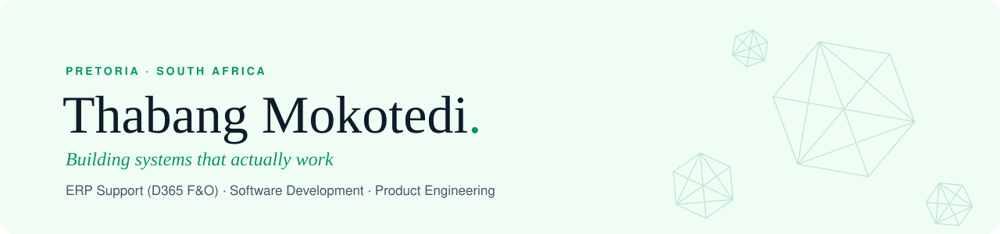

<picture>
  <source media="(prefers-color-scheme: dark)" srcset="assets/banner-dark.svg">
  
</picture>

  
  
  
  

I build software and keep business systems running. Day to day I support **Microsoft Dynamics 365 Finance & Operations** on an enterprise placement in Pretoria, where I also built the WhatsApp and email helpdesk the support team now works in daily. Outside of that I'm Head of Product Engineering and an equity partner at **[NexMotion Technologies](https://nexmotiontechnologies.co.za)**, leading design and frontend across Pampiri and our client sites.

**Right now**

- ERP Support Technician Intern — D365 F&O, via The Naked Scientists
- Head of Product Engineering · Equity Partner @ NexMotion Technologies
- Working towards a Microsoft Dynamics 365 certification
- Diploma in IT · Higher Certificate in IT *Cum Laude* — Central University of Technology

## Shipped

| | What it is | Built with |
|---|---|---|
| **[BidCalc](https://bidcalculator.co.za)** | Car auction cost calculator for South African buyers, with VAT modelled correctly against real auction invoices. Installable, works fully offline. Built for Kinetixes Engineering. |  |
| **[Pampiri](https://play.google.com/store/apps/details?id=com.nexmotiontechnologies.pampiri)** | Receipt scanning app for fleet operators and SMEs: scan, track per driver, export to Excel, PDF or CSV. I own the UI/UX and design system. |  |
| **[NexMotion client sites](https://nexmotiontechnologies.co.za/projects.html)** | 10+ live websites for clients in legal, hospitality, construction, education and nonprofit work. |  |
| **Appointment booking system** | Flutter mobile app syncing in real time with a C# / ASP.NET web app. Built during work-integrated learning at CUT. |  |

## Toolkit

Plus **Dynamics 365 F&O** administration, **SQL** (incl. Oracle), UAT coordination and helpdesk/SLA operations.

## How I work

- **Problem first, code second.** Understand what needs solving before building.
- **Clean over clever.** Code someone else can pick up in six months.
- **Ship real things.** BidCalc, Pampiri and the client sites are all live.
- **Bridge business and tech.** Translate between what the system does and what people need.

---

Pretoria, South Africa · Open to full-time roles in software development, enterprise systems and product engineering.
